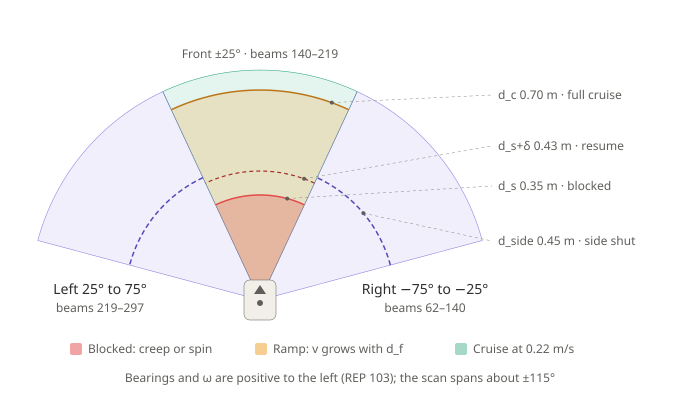
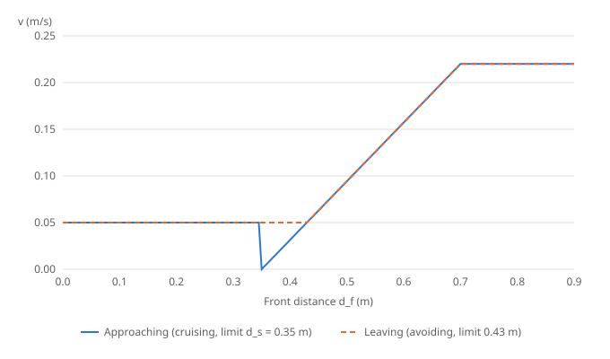
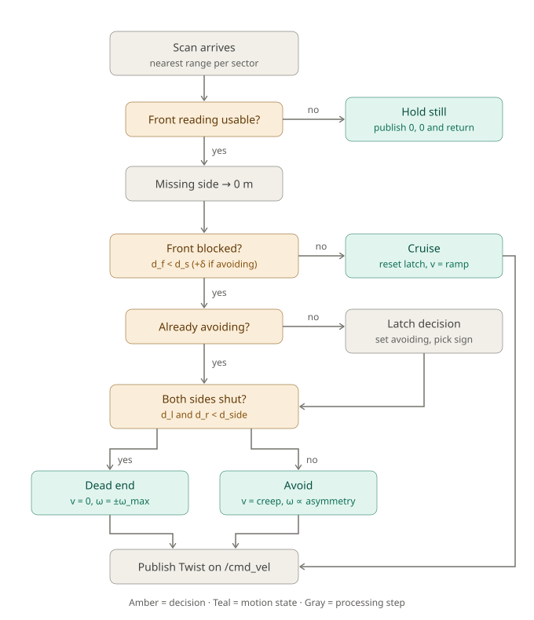

# Reactive obstacle avoidance: teaching notes

Teaching material for workshop task 4 (`reactive_avoid_SOLUTION.py`). All values use the default node parameters.

**Interactive simulator:** open [`index.html`](index.html) via GitHub Pages (see the setup notes at the bottom).

## 1. Sector geometry

## 2. Speed law and hysteresis

## 3. Decision flow of `on_scan`

## 4. Equation sheet

| Symbol | Parameter | Default |
|---|---|---|
| $d_s$ | `safety_radius` | 0.35 m |
| $\delta$ | `resume_margin` | 0.08 m |
| $d_{side}$ | `side_blocked` | 0.45 m |
| $d_c$ | `caution_radius` | 0.70 m |
| $v_{max}$ | `cruise_speed` | 0.22 m/s |
| $v_{creep}$ | `creep_speed` | 0.05 m/s |
| $\omega_{max}$ | `turn_speed_max` | 0.9 rad/s |

**Bearing to beam index.** The beams are evenly spaced, so $\theta_i = \theta_{min} + i\,\Delta\theta$. Solving for $i$:

$$i = \mathrm{round}\left(\frac{\theta - \theta_{min}}{\Delta\theta}\right), \quad \text{clamped to } [0, N-1]$$

Example: $\theta = -0.4363$ gives $i = \mathrm{round}(1.5637 / 0.011142) = \mathrm{round}(140.34) = 140$.

**Blocked test with hysteresis.**

$$\text{limit} = \begin{cases} d_s = 0.35 & \text{not avoiding} \\ d_s + \delta = 0.43 & \text{avoiding} \end{cases} \qquad \text{blocked} = d_f < \text{limit}$$

**Dead end.** $\text{blocked} \wedge d_l < d_{side} \wedge d_r < d_{side}$

**Turn direction.** $s = +1$ if $d_l > d_r$ and $s = -1$ if $d_r > d_l$. On a tie, keep the previous sign, or $+1$ if there is none. The sign is latched once per manoeuvre.

**Turn rate.**

$$A = \frac{d_l - d_r}{d_l + d_r} \in [-1, 1], \qquad \omega = \mathrm{clip}(\omega_{max} A,\ -\omega_{max},\ \omega_{max})$$

If $A$ is uninformative, or in a dead end, the node uses $\omega = s\,\omega_{max}$ instead.

Example: $d_l = 0.9$ and $d_r = 0.5$ give $A = 0.286$ and $\omega = +0.257$ rad/s.

**Forward speed.**

$$v = \begin{cases} 0 & \text{dead end} \\ v_{creep} & \text{blocked} \\ \mathrm{clip}\left(v_{max}\dfrac{d_f - d_s}{d_c - d_s},\ 0,\ v_{max}\right) & \text{clear} \end{cases}$$

Example: $d_f = 0.55$ gives $v = 0.22 \times 0.20 / 0.35 = 0.126$ m/s.

**Kinematics.** $\dot x = v\cos\phi$, $\dot y = v\sin\phi$, $\dot\phi = \omega$. The turn radius is $R = v/\omega$, so $v = 0$ means a pure spin.

## 5. Quiz

**Q1.** The robot is cruising. $d_f$ drops to 0.34 m, with $d_l = 0.90$ and $d_r = 0.50$. What is commanded?

Answer
The front is blocked (0.34 &lt; 0.35) and this is not a dead end, so <b>v = 0.05 m/s</b> and <b>ω = 0.9 × 0.4/1.4 ≈ +0.257 rad/s</b> (left).

**Q2.** Still avoiding, $d_f$ rises to 0.40 m. Which state is the robot in?

Answer
<b>AVOID.</b> While avoiding, the limit is 0.43 m, and 0.40 &lt; 0.43.

**Q3.** Why must `front_is_blocked()` run before `self.avoiding` is updated?

Answer
The threshold must match the state the robot was in when the scan arrived. Otherwise the state lags the decision by one scan.

**Q4.** Why creep at 0.05 m/s instead of stopping when one side is open?

Answer
Because $v &gt; 0$ makes the robot follow an arc of radius $R = v/\omega$ (about 0.19 m in Q1), so it slides past the obstacle instead of pivoting in place.

**Q5.** $d_l$ is `None`, $d_r = 0.60$ and the front is blocked. What happens?

Answer
The missing side becomes $d_l = 0$, so $A = -1$ and <b>ω = −0.9 rad/s</b>: a full-rate turn to the right.

**Q6.** Why does the dead end use $\omega = s\,\omega_{max}$?

Answer
The sides are nearly equal, so $A \approx 0$ and a proportional rate would rotate far too slowly.

**Q7.** What happens if the left and right windows are swapped?

Answer
The robot swerves towards obstacles instead of away from them.

## 6. Instructor notes

- `angular_for` takes its sign from $A$, not from the latched `turn_sign`, so the latch only matters in fallback cases. A suggested fix is `w = sign * w_max * abs(d_l - d_r) / total`.
- Near symmetry the turn rate is very small, for example 0.045 rad/s at $A = 0.05$. Consider adding a minimum turn rate.
- There is no hard stop: the robot keeps creeping forward however small $d_f$ gets.
- Edge beams 140 and 219 belong to two sectors each, because the sector bounds are inclusive.

## Viewing the simulator on GitHub

GitHub shows `.html` files as source code, so enable GitHub Pages to run the simulator. Go to **Settings → Pages**, set **Source** to *Deploy from a branch*, then choose **main** and the **/docs** folder. The page will then be served at `https://<user>.github.io/<repo>/`.
