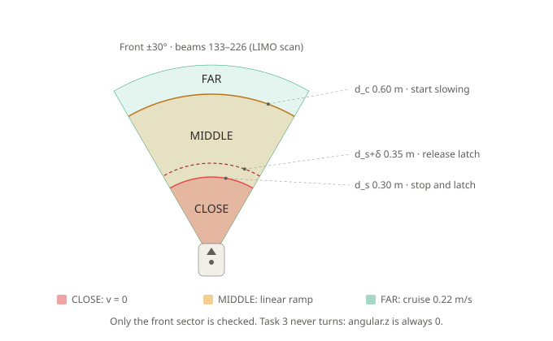
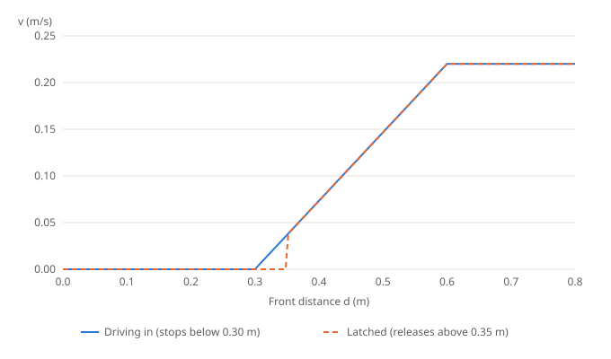
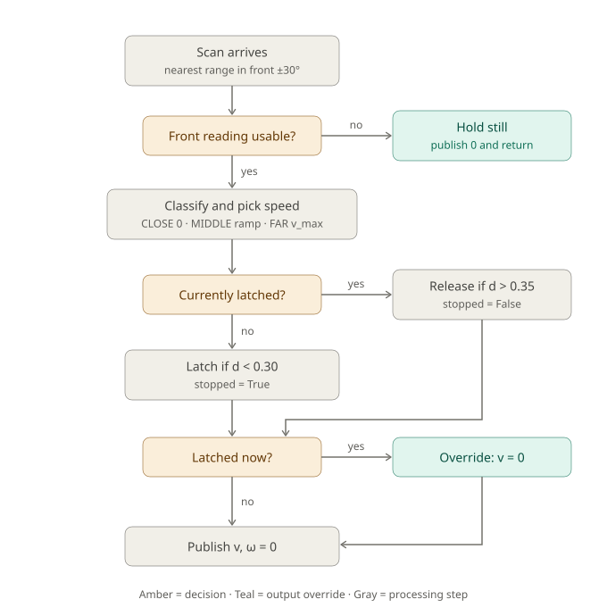

# Safe stop: teaching notes (task 3)

Teaching material for workshop task 3 (`safe_stop_SOLUTION.py`). All values use the default node parameters. The interactive simulator, which includes a noise test that shows why hysteresis matters, is in [`index.html`](index.html) and runs through GitHub Pages.

## 1. Front sector and stop zones

## 2. Speed law and hysteresis

## 3. Decision flow of `on_scan`

## 4. Equation sheet

| Symbol | Parameter | Default |
|---|---|---|
| $d_s$ | `safety_radius` | 0.30 m |
| $d_c$ | `caution_radius` | 0.60 m |
| $v_{max}$ | `cruise_speed` | 0.22 m/s |
| $\alpha$ | `front_half_angle` | 0.5236 rad (30°) |
| $\delta$ | `resume_margin` | 0.05 m |

**Bearing to beam index (blanks 1–2).** The beams are evenly spaced, so $\theta_i = \theta_{min} + i\,\Delta\theta$. Solving for $i$:

$$i = \mathrm{round}\left(\frac{\theta - \theta_{min}}{\Delta\theta}\right), \qquad i \leftarrow \max(0, \min(N-1, i))$$

For the LIMO scan ($\theta_{min} = -2.0$, $\Delta\theta = 0.011142$, $N = 360$), the right edge $\theta = -\alpha$ gives $\mathrm{round}(1.4764/0.011142) = \mathrm{round}(132.51) = 133$. The left edge $\theta = +\alpha$ gives $\mathrm{round}(226.49) = 226$. So the front sector is beams 133 to 226.

**Nearest obstacle (blanks 3–7).**

$$d = \min_{i \in [i_{lo},\, i_{hi}]} r_i$$

NaN readings are skipped. Readings that are $\infty$ or above `range_max` count as `range_max`, meaning clear. Readings below `range_min` are skipped. If no beam is usable, the result is `None` and the robot stops.

**Zones (blank 8).**

$$\text{zone} = \begin{cases} \text{CLOSE} & d < d_s \\ \text{MIDDLE} & d_s \le d < d_c \\ \text{FAR} & d \ge d_c \end{cases}$$

**Speed (blank 9).**

$$v = \begin{cases} 0 & \text{CLOSE} \\ v_{max}\,\dfrac{d - d_s}{d_c - d_s} & \text{MIDDLE} \\ v_{max} & \text{FAR} \end{cases}$$

The middle case is a straight line through $(d_s, 0)$ and $(d_c, v_{max})$, so $v$ is continuous at both boundaries. It can also be read as a proportional controller on the error $e = d - d_s$, with gain $K_p = v_{max}/(d_c - d_s) = 0.733\ \text{s}^{-1}$.

Example: $d = 0.45$ gives $v = 0.22 \times 0.15/0.30 = 0.110$ m/s.

**Hysteresis latch (blank 10).**

$$\text{stopped} \leftarrow \begin{cases} \text{true} & \text{not stopped and } d < d_s \\ \text{false} & \text{stopped and } d > d_s + \delta = 0.35 \\ \text{unchanged} & \text{otherwise} \end{cases} \qquad \text{if stopped: } v = 0$$

On release at $d$ just above 0.35, the ramp gives $v = 0.22 \times 0.05/0.30 \approx 0.037$ m/s.

**Stopping-distance check.** If the robot reacts after a delay $t_r$ and brakes at deceleration $a$, it travels $s = v t_r + v^2/(2a)$ before stopping. At full speed with $t_r = 0.1$ s (one 10 Hz scan) and $a = 1$ m/s², $s = 0.022 + 0.024 \approx 0.05$ m. The ramp means the robot is already slow by the time it reaches $d_s$, so the real overshoot is much smaller.

## 5. Quiz

**Q1.** $d = 0.45$ m and the robot is not latched. What speed is published?

Answer
MIDDLE zone: $v = 0.22 \times (0.45 - 0.30)/0.30 = 0.110$ m/s.

**Q2.** The robot has just stopped at 0.29 m. Noise makes the next scan read 0.32 m. What happens?

Answer
It stays stopped. The latch only releases above 0.35 m, so v = 0 even though the zone is MIDDLE.

**Q3.** Why is an `inf` reading replaced by `range_max` rather than skipped?

Answer
`inf` means the beam worked and found nothing, which is a clear direction. If every beam reads inf in an open room and they are all skipped, the sector looks empty and the robot would refuse to move.

**Q4.** Why does `min_front_range` return `None` instead of `range_max` when no beam is usable?

Answer
No data is not the same as clear. A safety check must assume the worst, so the caller stops.

**Q5.** A student sets `caution_radius` to 0.30, equal to `safety_radius`. What goes wrong?

Answer
The MIDDLE zone has zero width. The node only logs an error and keeps running. `speed_for` would divide by $d_c - d_s = 0$, but MIDDLE can never be reached in this case, so the robot just switches between 0 and $v_{max}$ with no ramp.

**Q6.** Without blank 10, what happens when the robot sits at $d \approx 0.30$ with ±1 cm of sensor noise?

Answer
It twitches. Readings below 0.30 give v = 0, and readings just above give a small positive v, so it starts and stops repeatedly. Try the noise test in the simulator.

**Q7.** Which beam indices make up the front sector on the LIMO, and why is `int()` needed?

Answer
Beams 133 to 226. `int()` is needed because `range()` only accepts integers.

## 6. Instructor notes

- **Link to task 4.** Task 3 stops when blocked, while task 4 creeps and turns. The `min_in_sector` helper and the ramp in task 4 are carried over from this task.
- **Inconsistent thresholds.** The latch uses strict inequalities ($d < d_s$ to latch and $d > d_s + \delta$ to release). Ask students what happens at exactly 0.35 m: it stays latched.
- **A teachable weakness.** With $\delta = 0$, the latch gives no protection from noise. Ask students to use the noise test to find the smallest $\delta$ that eliminates restarts at ±1 cm noise.
- **Defensive fix.** The `d_c <= d_s` check could raise an exception or swap the values instead of only logging, so a misconfigured robot never starts.
